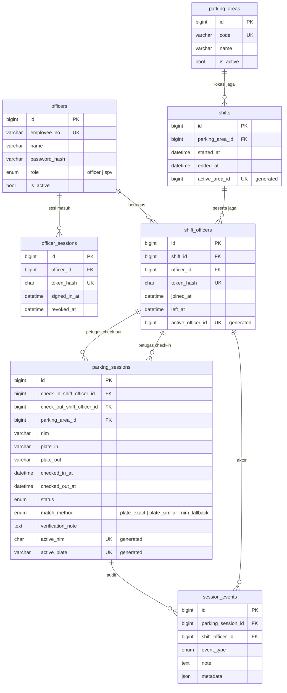

# Skema Database SmartPark

Skema database untuk sistem verifikasi check-in/check-out parkir motor mahasiswa berbasis QR KTM dan pengenalan plat nomor.

- **7 tabel:** `parking_areas`, `officers`, `officer_sessions`, `shifts`, `shift_officers`, `parking_sessions`, `session_events`
- **Prasyarat:** engine yang mendukung `CHECK` constraint dan stored generated column
- **Konvensi:** seluruh waktu disimpan UTC; nama tabel dan kolom `snake_case`

---

## 1. Prinsip Desain

1. **Sesi parkir adalah pusat data.** NIM dan plat hanya terikat pada satu sesi, bukan relasi permanen. Tidak ada tabel master mahasiswa maupun kendaraan.
2. **Dua peran, dua lingkup tulis.** `officer` mengoperasikan sesi parkir; `spv` mengelola lahan dan shift jaga. Pemisahan ini mengikuti kenyataan lapangan: yang menambah lahan dan mengatur periode jaga adalah pengawas, bukan petugas gerbang.
3. **Periode jaga dan petugas yang menjalaninya dipisah.** Satu shift adalah satu periode jaga di satu lahan, dan bisa dijalani **beberapa petugas sekaligus**. Karena itu penanggung jawab sebuah sesi ditunjuk pada tingkat petugas, bukan pada tingkat shift.
4. **Status sesi hanya berpindah dari `active`.** Dua jalur keluar: ditutup check-out (`matched` / `manual_verified`) atau dibatalkan (`voided`). Setelah itu statusnya terminal; riwayat tidak pernah dihapus.
5. **Penolakan check-out tidak mengubah status.** Sesi tetap `active`; penolakan dicatat sebagai event.
6. **Duplikasi dan tumpang tindih dijaga di level database.** Karena tidak ada *partial unique index*, dipakai **generated column + unique index** — kolom bernilai `NULL` saat baris tidak lagi relevan, dan unique index mengizinkan banyak `NULL`. Pola ini dipakai untuk: satu sesi aktif per NIM, satu sesi aktif per plat, satu penugasan jaga terbuka per petugas, dan satu shift terbuka per lahan.
7. **Normalisasi plat dilakukan di aplikasi** sebelum simpan/cari (lihat §5.2).
8. **Foto disimpan sebagai file**, bukan blob. Kolom hanya menyimpan path relatif.
9. **Waktu disimpan UTC** pada kolom `DATETIME` tanpa timezone. Batas hari untuk laporan dihitung dalam WIB.
10. **Data jaga bersifat append-only.** Shift dan penugasan jaga tidak pernah dihapus dan periode waktunya tidak pernah diedit; koreksi dilakukan dengan menambah baris baru.
11. **Yang tampil ke petugas hanya keadaan sistem** — "sesi ditemukan / tidak ditemukan" beserta data pembanding, bukan angka internal. Verifikasi dilakukan dengan melihat plat.
12. **Kolom yang bisa dihitung ulang dari data lain tidak disimpan**, kecuali ada alasan operasional yang eksplisit (§4.5).

---

## 2. Alur Bisnis

**Konteks.** Setiap petugas memakai perangkatnya sendiri, jadi satu shift bisa dilayani beberapa perangkat sekaligus. Sesi parkir hidup selama motor belum keluar — bisa hitungan jam, melewati pergantian petugas. Satu lahan bisa dijaga beberapa petugas sekaligus pada periode yang sama.

```
  CHECK-IN
  pindai KTM → NIM     pindai plat → OCR → koreksi / pindai ulang
                              │
                              ▼
                      status = active ──────────────────┐
                              │                         │ salah input NIM/plat
                              │                         │ → dibatalkan
  CHECK-OUT                   │                         ▼
  pindai plat → cari:         │                  status = voided
    exact → mirip → NIM       │                  NIM & plat bebas lagi
  cocokkan KTM visual         │
                              ▼
              ┌───────────────┼───────────────┐
              ▼               ▼               ▼
           ditolak         Sesuai      Verifikasi Manual
        (tetap active)   (matched)    (manual_verified)
                                       + catatan wajib
```

**Hubungan jaga.** Satu lahan membuka satu shift pada satu waktu; ke dalam shift itu beberapa petugas bergabung dan masing-masing mendapat token sendiri.

```
parking_areas 1 ──< shifts 1 ──< shift_officers >── 1 officers
                                   │
                                   └──< dipakai oleh parking_sessions & session_events
```

**Aturan kunci.**

| Aturan | Penegakan |
| --- | --- |
| NIM hanya divalidasi format (angka, panjang bebas) | Validasi aplikasi + `chk_sessions_nim` |
| Satu NIM / satu plat maksimal satu sesi aktif | `uq_sessions_active_nim`, `uq_sessions_active_plate` |
| Plat dinormalisasi sebelum disimpan/dicari | Normalisasi aplikasi + `chk_sessions_plate_in` |
| Check-out mencari plat berlapis: exact → mirip → NIM | §5.3 |
| Hasil meragukan tidak menutup sesi otomatis | Endpoint check-out hanya mengembalikan kandidat |
| Approval manual wajib catatan | `chk_sessions_manual_note` |
| Penolakan check-out tidak mengubah sesi | Hanya menambah baris di `session_events` |
| Retry klien tidak membuat data ganda | `uq_sessions_client_request` |
| Koreksi check-in salah | Status `voided` (§5.4) |
| Setiap penulisan data punya penanggung jawab | Token penugasan jaga wajib pada semua operasi sesi |
| Pengelolaan lahan & shift hanya oleh pengawas | `role = 'spv'` + `X-Officer-Token` (§5.6) |
| Satu lahan hanya punya satu shift terbuka | `uq_shifts_active_area` |
| Satu petugas hanya punya satu penugasan jaga terbuka | `uq_shift_officers_active_officer` |

**Di luar lingkup:** tabel mahasiswa/nama/prodi, tabel kendaraan permanen, pembayaran, reservasi, slot, CCTV, RFID, palang otomatis, validasi STNK, antrian offline di server. Durasi parkir tidak disimpan — dihitung dari `checked_in_at`.

---

## 3. ERD



---

## 4. Detail Tabel

### 4.1 `parking_areas` — lahan/pos parkir

| Kolom | Tipe | Null | Default | Keterangan |
| --- | --- | --- | --- | --- |
| `id` | `BIGINT UNSIGNED` | no | auto | PK |
| `code` | `VARCHAR(32)` | no | — | Kode unik lahan, mis. `POS-UTAMA` |
| `name` | `VARCHAR(100)` | no | — | Nama tampilan |
| `is_active` | `TINYINT(1)` | no | `1` | Nonaktifkan lahan tanpa hapus data |
| `created_at`, `updated_at` | `TIMESTAMP` | no | otomatis | Diisi otomatis saat baris dibuat/diubah (UTC) |

Index: `UNIQUE (code)`.

### 4.2 `officers` — petugas parkir

| Kolom | Tipe | Null | Default | Keterangan |
| --- | --- | --- | --- | --- |
| `id` | `BIGINT UNSIGNED` | no | auto | PK |
| `employee_no` | `VARCHAR(32)` | yes | `NULL` | NIP/ID petugas bila ada; unik bila diisi |
| `name` | `VARCHAR(100)` | no | — | Nama lengkap, dipakai di antarmuka dan laporan |
| `phone` | `VARCHAR(20)` | yes | `NULL` | Kontak untuk investigasi |
| `password_hash` | `VARCHAR(255)` | yes | `NULL` | Hash password petugas. `NULL` = belum diatur admin → tidak boleh bertugas |
| `role` | `VARCHAR(16)` | no | `'officer'` | `officer` atau `spv`. Lihat §5.6 |
| `is_active` | `TINYINT(1)` | no | `1` | Petugas berhenti → nonaktif, jangan dihapus |
| `created_at`, `updated_at` | `TIMESTAMP` | no | otomatis | Diisi otomatis saat baris dibuat/diubah (UTC) |

| Nama | Tipe | Kolom | Alasan |
| --- | --- | --- | --- |
| `uq_officers_employee_no` | UNIQUE | `employee_no` | NIP tidak boleh dobel |
| `idx_officers_name` | INDEX | `name` | Daftar pilih-nama diurutkan per nama |
| `chk_officers_role` | CHECK | `role IN ('officer','spv')` | Peran hanya dua nilai |

Nama constraint `CHECK` berprefix `chk_officers_` agar unik per schema.

> **Database yang sudah berjalan.** `create_all` tidak pernah menambah kolom atau constraint ke tabel yang sudah ada. Karena itu ada modul migrasi yang dijalankan saat aplikasi mulai: ia menambahkan kolom `role` dan constraint `chk_officers_role`. SQLite tidak mendukung `ADD CONSTRAINT`, jadi tabel `officers` dibangun ulang (foreign key dimatikan sementara, data disalin, tabel diganti, indeks dibuat ulang) dalam satu transaksi. Prosedurnya idempoten — dijalankan berulang tidak mengubah apa pun.

### 4.3 `shifts` — periode jaga di satu lahan

Satu baris = satu periode jaga. `ended_at IS NULL` berarti shift masih berjalan. Shift tidak memuat identitas petugas — siapa saja yang bertugas dicatat di `shift_officers`.

> **Perangkat tidak dimodelkan.** Identitas pelaku bersandar pada petugas, bukan perangkat. Setiap petugas memakai perangkatnya sendiri, sehingga satu shift bisa dilayani beberapa perangkat sekaligus dan satu kolom perangkat di `shifts` tidak bisa memuatnya. Perangkat yang menempel di shift juga akan menyesatkan — ia tampak seperti milik seluruh shift padahal hanya dipakai sebagian petugas di dalamnya. Karena itu yang dicatat adalah lahan dan periode jaga, sedangkan identitas pelaku ada di `shift_officers`.

| Kolom | Tipe | Null | Default | Keterangan |
| --- | --- | --- | --- | --- |
| `id` | `BIGINT UNSIGNED` | no | auto | PK |
| `parking_area_id` | `BIGINT UNSIGNED` | no | — | FK → `parking_areas.id`, lahan yang dijaga |
| `started_at` | `DATETIME` | no | — | Mulai jaga (UTC) |
| `ended_at` | `DATETIME` | yes | `NULL` | Selesai jaga (UTC); `NULL` = masih berjalan |
| `end_note` | `TEXT` | yes | `NULL` | Mis. "pos tutup lebih awal" |
| `active_area_id` | `BIGINT UNSIGNED` **GENERATED STORED** | yes | — | `IF(ended_at IS NULL, parking_area_id, NULL)` |
| `created_at`, `updated_at` | `TIMESTAMP` | no | otomatis | Diisi otomatis saat baris dibuat/diubah (UTC) |

| Nama | Tipe | Kolom | Alasan |
| --- | --- | --- | --- |
| `uq_shifts_active_area` | UNIQUE | `active_area_id` | Satu lahan maksimal satu shift terbuka |
| `idx_shifts_area_period` | INDEX | `(parking_area_id, started_at, ended_at)` | Riwayat shift per lahan |
| `chk_shifts_period` | CHECK | `ended_at IS NULL OR ended_at >= started_at` | Durasi tidak boleh negatif |

### 4.4 `shift_officers` — petugas yang bertugas dalam satu shift

Satu baris = satu penugasan: seorang petugas ikut serta dalam satu shift. `left_at IS NULL` berarti petugas masih bertugas. Inilah penunjuk identitas yang dipakai sesi dan event.

| Kolom | Tipe | Null | Default | Keterangan |
| --- | --- | --- | --- | --- |
| `id` | `BIGINT UNSIGNED` | no | auto | PK |
| `shift_id` | `BIGINT UNSIGNED` | no | — | FK → `shifts.id` |
| `officer_id` | `BIGINT UNSIGNED` | no | — | FK → `officers.id` |
| `token_hash` | `CHAR(64)` | yes | `NULL` | Hash token milik petugas ini; dikosongkan saat ia berhenti bertugas |
| `joined_at` | `DATETIME` | no | — | Mulai bertugas (UTC) |
| `left_at` | `DATETIME` | yes | `NULL` | Selesai bertugas (UTC); `NULL` = masih bertugas |
| `left_note` | `TEXT` | yes | `NULL` | Mis. "serah terima ke petugas pengganti" |
| `active_officer_id` | `BIGINT UNSIGNED` **GENERATED STORED** | yes | — | `IF(left_at IS NULL, officer_id, NULL)` |
| `created_at`, `updated_at` | `TIMESTAMP` | no | otomatis | Diisi otomatis saat baris dibuat/diubah (UTC) |

| Nama | Tipe | Kolom | Alasan |
| --- | --- | --- | --- |
| `uq_shift_officers_active_officer` | UNIQUE | `active_officer_id` | Satu petugas maksimal satu penugasan terbuka |
| `uq_shift_officers_token` | UNIQUE | `token_hash` | Token tidak boleh dipakai dua penugasan |
| `idx_shift_officers_shift` | INDEX | `(shift_id, joined_at)` | Siapa saja yang bertugas dalam satu shift |
| `idx_shift_officers_officer` | INDEX | `(officer_id, joined_at)` | Riwayat bertugas per petugas |
| `chk_shift_officers_period` | CHECK | `left_at IS NULL OR left_at >= joined_at` | Durasi tidak boleh negatif |
| `chk_shift_officers_open_token` | CHECK | `left_at IS NOT NULL OR token_hash IS NOT NULL` | Penugasan terbuka wajib punya token |

Petugas bisa bergabung dan berhenti kapan saja selama shift berjalan, sehingga `joined_at`/`left_at` tidak selalu sama dengan `started_at`/`ended_at` milik shift.

### 4.5 `parking_sessions` — sesi parkir

| Kolom | Tipe | Null | Default | Keterangan |
| --- | --- | --- | --- | --- |
| `id` | `BIGINT UNSIGNED` | no | auto | PK |
| `check_in_shift_officer_id` | `BIGINT UNSIGNED` | no | — | FK → `shift_officers.id`: petugas yang memproses check-in |
| `check_out_shift_officer_id` | `BIGINT UNSIGNED` | yes | `NULL` | FK → `shift_officers.id`: petugas yang menutup sesi |
| `parking_area_id` | `BIGINT UNSIGNED` | no | — | Lahan tempat motor terparkir |
| `nim` | `VARCHAR(32)` | no | — | NIM ternormalisasi; panjang tidak dipatok, hanya angka |
| `plate_in` | `VARCHAR(12)` | no | — | Plat check-in ternormalisasi |
| `plate_out` | `VARCHAR(12)` | yes | `NULL` | Plat check-out ternormalisasi |
| `checked_in_at` | `DATETIME` | no | — | Waktu masuk (UTC) |
| `checked_out_at` | `DATETIME` | yes | `NULL` | Waktu keluar (UTC) |
| `status` | `ENUM('active','matched','manual_verified','voided')` | no | `active` | Lihat §5.4 |
| `match_method` | `ENUM('plate_exact','plate_similar','nim_fallback')` | yes | `NULL` | Cara sesi ditemukan saat check-out |
| `verification_note` | `TEXT` | yes | `NULL` | Wajib bila `manual_verified` atau `voided` |
| `plate_in_photo_path` | `VARCHAR(255)` | yes | `NULL` | Path snapshot plat check-in |
| `plate_out_photo_path` | `VARCHAR(255)` | yes | `NULL` | Path snapshot plat check-out |
| `client_request_id` | `CHAR(36)` | yes | `NULL` | Kunci idempotensi untuk retry klien |
| `active_nim` | `VARCHAR(32)` **GENERATED STORED** | yes | — | `IF(status='active', nim, NULL)` |
| `active_plate` | `VARCHAR(12)` **GENERATED STORED** | yes | — | `IF(status='active', plate_in, NULL)` |
| `created_at`, `updated_at` | `TIMESTAMP` | no | otomatis | Diisi otomatis saat baris dibuat/diubah (UTC) |

| Nama | Tipe | Kolom | Alasan |
| --- | --- | --- | --- |
| `uq_sessions_active_nim` | UNIQUE | `active_nim` | Satu NIM = maksimal satu sesi aktif |
| `uq_sessions_active_plate` | UNIQUE | `active_plate` | Satu plat = maksimal satu sesi aktif |
| `uq_sessions_client_request` | UNIQUE | `client_request_id` | Retry check-in tidak membuat sesi ganda |
| `idx_sessions_status_in` | INDEX | `(status, checked_in_at)` | Daftar kendaraan masih parkir |
| `idx_sessions_nim` | INDEX | `(nim, checked_in_at)` | Riwayat/pencarian per NIM |
| `idx_sessions_plate_in` | INDEX | `plate_in` | Lookup check-out exact match |
| `idx_sessions_plate_out` | INDEX | `plate_out` | Riwayat per plat keluar |
| `idx_sessions_area_in` | INDEX | `(parking_area_id, checked_in_at)` | Investigasi per lahan + rentang waktu |
| `idx_sessions_in_assign` | INDEX | `check_in_shift_officer_id` | Sesi yang ditangani petugas ini |
| `idx_sessions_out_assign` | INDEX | `check_out_shift_officer_id` | Idem untuk check-out |
| `idx_sessions_out_at` | INDEX | `checked_out_at` | Hitungan "keluar hari ini" |
| `idx_sessions_updated` | INDEX | `updated_at` | Daftar aktivitas terbaru |
| `chk_sessions_nim` | CHECK | `REGEXP_LIKE(nim,'^[0-9]+$')` | NIM hanya berisi angka |
| `chk_sessions_plate_in` | CHECK | `REGEXP_LIKE(plate_in,'^[A-Z0-9]{1,12}$','c')` | Plat sudah ternormalisasi |
| `chk_sessions_plate_out` | CHECK | `plate_out IS NULL OR REGEXP_LIKE(plate_out,'^[A-Z0-9]{1,12}$','c')` | Idem |
| `chk_sessions_period` | CHECK | `checked_out_at IS NULL OR checked_out_at >= checked_in_at` | Waktu keluar tidak mendahului waktu masuk |
| `chk_sessions_status_times` | CHECK | `active`/`voided` ⟺ (`checked_out_at` ∧ `check_out_shift_officer_id` keduanya `NULL`); status lain wajib terisi keduanya | Konsistensi status, waktu, petugas penutup |
| `chk_sessions_manual_note` | CHECK | `manual_verified` atau `voided` ⟹ catatan tidak kosong | Approval manual & pembatalan wajib beralasan |
| `chk_sessions_match_method` | CHECK | `match_method IS NULL OR match_method IN ('plate_exact','plate_similar','nim_fallback')` | Nilai `ENUM` dikunci `CHECK` agar tetap berlaku di engine yang tidak punya `ENUM` |

> **`parking_area_id` disimpan sengaja meski bisa diturunkan** lewat `check_in_shift_officer_id` → `shift_officers.shift_id` → `shifts.parking_area_id`. Alasannya: lokasi parkir adalah fakta tentang sesi itu sendiri, dan menyimpannya menghindari join berlapis pada query investigasi yang paling sering dipakai. Ini pengecualian yang disadari terhadap prinsip 11.
>
> Nama `CHECK` constraint wajib unik per schema — karena itu semuanya berprefix `chk_sessions_`, `chk_shifts_`, atau `chk_shift_officers_`.
> **Nilai `ENUM` juga dikunci `CHECK`.** Tipe `ENUM` hanya menegakkan nilainya di engine yang punya tipe itu; SQLite menyimpannya sebagai `VARCHAR` sehingga nilainya bebas. Karena skema ini harus berlaku di kedua engine, setiap kolom `ENUM` mendapat `CHECK` padanannya — `chk_sessions_match_method` dan `chk_events_event_type`. `status` sudah terkunci lewat `chk_sessions_status_times`, yang hanya menerima keempat nilai yang sah.
> `CHECK` tidak dipasang pada kolom yang dipakai aksi referensial foreign key.
> `check_in_shift_officer_id` sengaja `NOT NULL`: sesi tidak mungkin dibuat tanpa petugas penanggung jawab.

### 4.6 `session_events` — jejak audit sesi

Menampung hal yang tidak terwakili oleh kolom sesi: penolakan check-out, pembatalan check-in, dan riwayat verifikasi manual.

| Kolom | Tipe | Null | Default | Keterangan |
| --- | --- | --- | --- | --- |
| `id` | `BIGINT UNSIGNED` | no | auto | PK |
| `parking_session_id` | `BIGINT UNSIGNED` | no | — | FK → `parking_sessions.id`, `ON DELETE CASCADE` |
| `shift_officer_id` | `BIGINT UNSIGNED` | no | — | FK → `shift_officers.id`: petugas pelaku kejadian |
| `event_type` | `ENUM('check_in','check_out_closed','check_out_rejected','manual_verification','check_in_voided')` | no | — | Jenis kejadian |
| `note` | `TEXT` | yes | `NULL` | Catatan/alasan |
| `metadata` | `JSON` | yes | `NULL` | Payload tambahan: status lama, `match_method`, `client_request_id` |
| `created_at` | `TIMESTAMP` | no | otomatis | Diisi otomatis saat baris dibuat (UTC) |

Index: `INDEX (parking_session_id, created_at)`, `INDEX (shift_officer_id)`.

| Nama | Tipe | Kolom | Alasan |
| --- | --- | --- | --- |
| `chk_events_event_type` | CHECK | `event_type IN ('check_in','check_out_closed','check_out_rejected','manual_verification','check_in_voided')` | Nilai `ENUM` dikunci `CHECK` agar tetap berlaku di engine yang tidak punya `ENUM` |

### 4.7 `officer_sessions` — sesi masuk petugas di luar shift

Satu baris = satu sesi masuk. `revoked_at IS NULL` berarti sesi masih berlaku.

Sesi ini menutup celah otorisasi: menambah lahan dan mengatur shift jaga berjalan **sebelum** ada shift sama sekali, sehingga tidak mungkin memakai token penugasan jaga. Sesi parkir tetap memakai token penugasan (§4.4), karena setiap sesi wajib punya penanggung jawab jaga.

| Kolom | Tipe | Null | Default | Keterangan |
| --- | --- | --- | --- | --- |
| `id` | `BIGINT UNSIGNED` | no | auto | PK |
| `officer_id` | `BIGINT UNSIGNED` | no | — | FK → `officers.id`, pemilik sesi |
| `token_hash` | `CHAR(64)` | no | — | Hash token sesi; dikosongkan tidak dilakukan — baris dicabut lewat `revoked_at` |
| `signed_in_at` | `DATETIME` | no | — | Waktu masuk (UTC) |
| `revoked_at` | `DATETIME` | yes | `NULL` | Waktu keluar (UTC); `NULL` = masih berlaku |
| `created_at`, `updated_at` | `TIMESTAMP` | no | otomatis | Diisi otomatis saat baris dibuat/diubah (UTC) |

| Nama | Tipe | Kolom | Alasan |
| --- | --- | --- | --- |
| `uq_officer_sessions_token` | UNIQUE | `token_hash` | Token tidak boleh dipakai dua sesi |
| `idx_officer_sessions_officer` | INDEX | `(officer_id, signed_in_at)` | Riwayat masuk per petugas |

Token sesi **tidak** dikosongkan saat keluar, berbeda dari `shift_officers.token_hash`. Alasannya: `shift_officers` memakai kolom yang sama untuk dua hal (bukti penugasan terbuka **dan** kredensial), sedangkan di sini status hidup sesi sudah diwakili `revoked_at`. Baris tetap utuh sebagai jejak audit.

Petugas boleh punya lebih dari satu sesi terbuka (mis. masuk dari HP dan dari laptop); yang dibatasi hanya satu penugasan jaga terbuka per petugas (`uq_shift_officers_active_officer`).

---

## 5. Aturan & Konvensi

### 5.1 Format NIM

NIM hanya divalidasi formatnya, bukan keaslian atau keaktifan mahasiswa. Panjangnya **tidak dipatok** karena berbeda-beda antar institusi.

| Aturan | Nilai |
| --- | --- |
| Karakter yang diizinkan | angka `0-9` saja |
| Panjang | bebas, dibatasi `nim_min_length`–`nim_max_length` di konfigurasi aplikasi (bawaan 1–32) |
| Penyimpanan | `VARCHAR(32)`; kolom `active_nim` mengikuti |
| Normalisasi | spasi di awal dan akhir dibuang |

`nim_max_length` di konfigurasi **tidak boleh melebihi** lebar kolom `VARCHAR(32)`. Bila perlu lebih panjang, ubah kolomnya lebih dulu.

### 5.2 Normalisasi plat

```
input  : "  b 1234  xyz "   (hasil OCR, bisa ada spasi/tanda baca)
output : "B1234XYZ"
langkah: uppercase → buang semua karakter selain A-Z dan 0-9 → potong maks 12
```

Dilakukan di aplikasi sebelum simpan maupun cari. `chk_sessions_plate_in` menjadi pertahanan kedua di database.

### 5.3 Pencocokan plat saat check-out

Yang dibandingkan adalah **plat hasil scan** versus `plate_in` setiap sesi aktif. Ini kemiripan teks — bukan kemiripan foto dan bukan bukti identitas.

Langkah pencarian, berurutan:

1. Cari `plate_in = plat_out` (exact) → `plate_exact`.
2. Bila gagal, hitung jarak edit ke setiap sesi aktif, ambil kandidat dengan **jarak edit ≤ ambang** → `plate_similar`.
3. Bila tidak ada kandidat dalam ambang, cari berdasarkan NIM → `nim_fallback`.
4. Bila tetap tidak ada → "Sesi tidak ditemukan" + opsi pindai ulang atau cari via NIM.

Plat check-out **tidak dikonfirmasi petugas lebih dulu** — hasil scan langsung dikirim, lalu hasil pencariannya ditampilkan. Karena itu OCR di gerbang keluar rawan salah (motor bergerak, cahaya, sudut) dan langkah fuzzy benar-benar terpakai.

**Yang dilihat petugas: keadaan, bukan angka.**

| Keadaan | Yang ditampilkan | Tindakan petugas |
| --- | --- | --- |
| Ditemukan pasti | "Sesi ditemukan" + NIM + data check-in | Cocokkan KTM → tutup sebagai Sesuai |
| Ditemukan mirip | Daftar kandidat, platnya saja | Bandingkan dengan plat fisik motor → pilih → tutup sebagai Verifikasi Manual + catatan |
| Tidak ditemukan | "Sesi tidak ditemukan" | Pindai ulang atau cari via NIM |

Pada keadaan "mirip", petugas membandingkan plat kandidat secara visual. Angka kemiripan tidak ditampilkan dan tidak disimpan — angka tinggi tidak membuktikan motor itu yang benar.

**Ambang** disimpan di konfigurasi aplikasi agar bisa diubah tanpa deploy. Fungsinya hanya menentukan kapan kandidat ditampilkan dan berapa banyak. Usulan awal: jarak edit ≤ 1 untuk plat 9 karakter, disetel ulang setelah ada data nyata.

Keputusan akhir selalu milik petugas; sistem tidak menutup sesi otomatis.

### 5.4 Semantik status

| Status | Label | `checked_out_at` | `check_out_shift_officer_id` | `verification_note` |
| --- | --- | --- | --- | --- |
| `active` | Aktif | `NULL` | `NULL` | opsional |
| `matched` | Sesuai | terisi | terisi | opsional |
| `manual_verified` | Verifikasi Manual | terisi | terisi | **wajib** |
| `voided` | Dibatalkan | `NULL` | `NULL` | **wajib** (alasan pembatalan) |

```
active ──┬── ditutup check-out  → matched / manual_verified
         └── dibatalkan         → voided
```

Setelah keluar dari `active`, statusnya terminal.

**Pembatalan check-in (`voided`).** Check-in bisa salah: QR KTM gagal → NIM diinput manual → satu digit keliru. Sesi salah akan mengunci `active_nim` dan `active_plate` lewat unique index, sehingga mahasiswa maupun plat itu tidak bisa check-in lagi. Status `voided` memberi jalan keluar: karena `active_nim`/`active_plate` hanya berisi nilai saat `status = 'active'`, mengubah status otomatis mengosongkan keduanya dan NIM/plat langsung bebas dipakai ulang. Baris tidak dihapus, jadi jejak kesalahan tetap tersimpan.

| Aspek | Aturan |
| --- | --- |
| Status awal | Hanya `active` yang boleh dibatalkan |
| Wajib catatan | `verification_note` diisi alasan pembatalan |
| Pelaku | Tercatat di `session_events` sebagai `check_in_voided` |
| `checked_out_at` | Tetap `NULL` — tidak ikut terhitung di "keluar hari ini" |
| Riwayat | Tidak muncul di daftar riwayat biasa; hanya di tampilan audit |
| Pengulangan | Membatalkan sesi yang sudah `voided` tidak mengubah apa pun dan tidak menambah event |

Pembatalan hanya membatalkan, tidak memperbaiki NIM. Petugas kemudian membuat sesi baru dengan data yang benar, sehingga tiap baris tetap merekam satu peristiwa nyata.

### 5.5 Autentikasi petugas & siklus jaga

Tidak ada username yang diketik. Petugas memilih namanya dari daftar, lalu memasukkan password. Satu pintu masuk melayani dua peran; yang membedakan hanya apa yang boleh dilakukan sesudahnya (§5.6).

**Dua jalur setelah masuk.**

```
A. Mengelola (pengawas)          B. Bertugas (petugas gerbang)
   1. Pilih nama dari daftar        1. Pilih nama dari daftar
   2. Masukkan password             2. Masukkan password
   3. Terima X-Officer-Token        3. Sebutkan lahan yang dijaga
   4. Kelola lahan & shift          4. Sistem mencari shift terbuka:
                                        ada   → bergabung ke shift itu
                                        tidak → membuat shift baru, lalu bergabung
                                    5. Terima X-Shift-Token untuk penugasan itu
```

Kedua jalur bisa dipakai bergantian oleh orang yang sama. Pengawas yang ikut berjaga memakai jalur B, sehingga penanggung jawab sesinya tetap tercatat.

Petugas berikutnya yang datang di lahan yang sama akan bergabung ke shift yang sama dan mendapat token sendiri. Karena setiap petugas punya token sendiri, penanggung jawab tiap sesi tetap bisa dibedakan meski shiftnya sama.

Nama dipilih dari daftar karena perangkat di satu pos bisa dipakai siapa saja yang sedang bertugas. Bila nanti dibutuhkan username, `employee_no` bisa dipakai tanpa mengubah skema.

**Tiga kredensial, tiga umur.**

| | `officers.password_hash` | `officer_sessions.token_hash` | `shift_officers.token_hash` |
| --- | --- | --- | --- |
| Untuk apa | membuktikan petugas memilih namanya sendiri | mengautentikasi operasi pengelolaan di luar shift | mengautentikasi operasi sesi parkir selama bertugas |
| Dibuat kapan | sekali, saat petugas didaftarkan | setiap kali petugas masuk | setiap kali petugas bergabung ke shift |
| Digenerate ulang? | Tidak — permanen sampai diganti admin | Ya — token baru tiap masuk | Ya — token baru tiap penugasan |
| Saat berhenti | tidak tersentuh | baris dicabut lewat `revoked_at` | `token_hash` dikosongkan → token langsung mati |
| Dikirim ke klien? | tidak pernah | ya, sekali saat masuk | ya, sekali saat bergabung |
| Header | — | `X-Officer-Token` | `X-Shift-Token` |

`officer_sessions` menutup celah yang muncul bersama peran pengawas: menambah lahan dan mengatur shift terjadi **sebelum** ada shift, jadi tidak mungkin memakai token penugasan jaga.

| Aspek password | Aturan |
| --- | --- |
| Panjang minimum | 6 karakter |
| Kompleksitas | tidak dipaksa simbol/huruf besar |
| Algoritma hash | hash lambat dengan salt per baris |
| Dibuat/diganti | admin; tidak ada reset mandiri |
| Pembatasan percobaan | wajib — mis. 5 percobaan gagal per menit per petugas |

Password adalah rahasia buatan manusia berentropi rendah → wajib hash lambat agar percobaan offline mahal. Token adalah string acak berentropi tinggi → hash cepat aman, dan dibutuhkan karena `token_hash` dicari setiap permintaan.

**Aturan yang ditegakkan sistem.**

1. Satu lahan hanya boleh punya satu shift terbuka (`uq_shifts_active_area`) — petugas yang datang berikutnya bergabung ke shift itu, bukan membuka shift kedua.
2. Satu petugas hanya boleh punya satu penugasan jaga terbuka (`uq_shift_officers_active_officer`). Inilah yang mencegah satu orang bertugas di dua lahan sekaligus.
3. Permintaan dengan token yang penugasannya sudah ditutup ditolak.
4. Operasi sesi parkir (check-in, check-out, penolakan, pembatalan) mewajibkan token penugasan aktif. Peran tidak menggantikannya.
5. Operasi pengelolaan (lahan, shift jaga) mewajibkan `X-Officer-Token` dengan `role = 'spv'` (§5.6).
6. Petugas tanpa password atau berstatus nonaktif tidak boleh masuk, baik untuk mengelola maupun untuk bergabung ke shift.
7. Lahan nonaktif tidak boleh membuka shift baru.
8. Shift yang lupa ditutup ditutup paksa dengan catatan, bukan dihapus.
9. Shift terbuka wajib punya minimal satu penugasan aktif, **kecuali** shift yang baru dibuka pengawas dan belum ada petugas yang datang. Ini tidak bisa ditegakkan `CHECK` karena membutuhkan subquery — menjadi tanggung jawab aplikasi.
10. Menutup shift menutup seluruh penugasan di dalamnya, dalam satu transaksi (§6).

### 5.6 Peran dan lingkup otorisasi

Dua peran pada `officers.role`, dengan lingkup tulis yang tidak tumpang tindih.

| | `officer` | `spv` |
| --- | --- | --- |
| Kredensial operasi | `X-Shift-Token` (§5.5) | `X-Officer-Token` (§5.5) |
| Sesi parkir (check-in, check-out, tolak, batal) | ya | ya |
| Menambah / mengubah lahan | tidak | ya |
| Membuka / menutup shift jaga | tidak | ya |
| Membuat / mengubah akun petugas, termasuk mengubah peran | tidak | ya |
| Melihat lahan, shift, riwayat | ya | ya |

**Aturan yang ditegakkan sistem.**

1. Operasi sesi parkir wajib `X-Shift-Token` — peran tidak menggantikannya, karena setiap sesi wajib punya penanggung jawab jaga.
2. Operasi pengelolaan lahan, shift, dan akun petugas mewajibkan `X-Officer-Token` **dan** `role = 'spv'`; peran `officer` ditolak `403 not_spv`.
3. Pengawas tidak otomatis mendapat penugasan jaga. Untuk memproses sesi, ia tetap harus bergabung ke shift seperti petugas lain.
4. Menutup shift adalah wewenang pengawas (`POST /api/shifts/{id}/close`), termasuk penutupan paksa shift yang lupa ditutup (§5.5 aturan 8).
5. Peran hanya diubah lewat `PATCH /api/officers/{id}`, dan endpoint itu sendiri dijaga pengawas — sehingga **tidak ada cara menaikkan peran sendiri** dari aplikasi.
6. Daftar lahan dan daftar petugas sengaja **tetap terbuka** karena layar masuk memanggilnya sebelum ada token; keduanya hanya memuat nama, kode, dan peran.
7. Daftar shift justru **wajib sesi**: responsnya memuat nama petugas yang bertugas, jadi tidak boleh terbuka untuk umum.

> **Mengapa peran ada di `officers`, bukan tabel terpisah.** Satu orang bisa berperan sebagai pengawas sekaligus bertugas di gerbang; memisahkan tabel memaksa dua identitas untuk satu manusia, dan penanggung jawab sesi (`check_in_shift_officer_id`) akan menunjuk ke baris yang berbeda dari identitas masuknya.

> **Kepemilikan lahan tidak dimodelkan.** Pengawas mengelola **semua** lahan, bukan sebagian. Bila nanti satu pengawas hanya boleh mengelola lahan tertentu, tambahkan tabel relasi `area_supervisors` — kolom `role` tetap dipakai untuk menentukan siapa yang boleh mengelola.

---

## 6. Catatan

- **Jangan hapus data audit.** `officers`, `officer_sessions`, `shifts`, `shift_officers`, `parking_sessions`, `session_events` adalah jejak audit — jadwalkan backup harian dan jangan pernah menghapus baris dari tabel-tabel ini.
- **Jangan hapus petugas.** Foreign key akan menolak. Petugas berhenti cukup dinonaktifkan.
- **Koreksi jaga yang salah.** Karena append-only, jangan mengubah `started_at`/`ended_at` maupun `joined_at`/`left_at`; tutup yang salah dengan catatan lalu buat baris baru.
- **Menutup shift berarti menutup semua penugasan di dalamnya.** Set `shifts.ended_at` bersamaan dengan `shift_officers.left_at` untuk setiap penugasan yang masih terbuka, dalam satu transaksi.
- **Pembatalan check-in bukan penghapusan.** Sesi `voided` tidak ikut hitungan beranda: tidak masuk "aktif sekarang", tidak masuk "keluar hari ini", dan "masuk hari ini" perlu filter `status <> 'voided'` eksplisit.
- **Kunci duplikasi.** Pelanggaran `uq_sessions_active_nim` / `uq_sessions_active_plate` harus dilaporkan sebagai "NIM/plat sudah punya sesi aktif", bukan sebagai kesalahan sistem. Begitu juga `uq_shifts_active_area` → "Lahan ini sudah punya shift terbuka", dan `uq_shift_officers_active_officer` → "Petugas ini masih bertugas di shift lain".
- **Volume.** Satu pos menghasilkan puluhan–ratusan baris sesi per hari; skema aman tanpa partisi. `parking_sessions` adalah tabel terbesar — arsipkan per tahun bila perlu.
- **Pencarian riwayat** memakai `nim OR plate_in OR plate_out` sehingga tidak bisa memakai satu index. Pantau saat uji beban.
